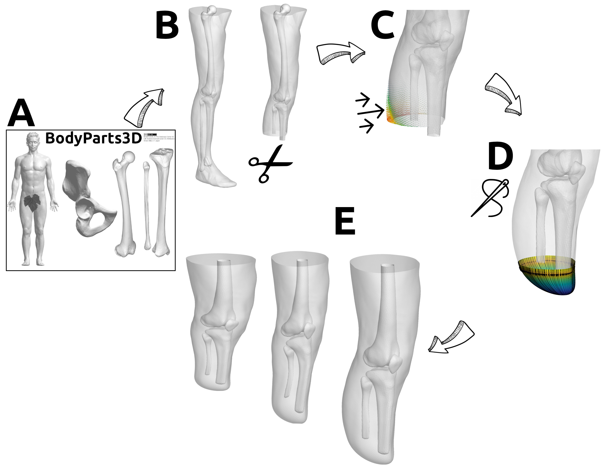
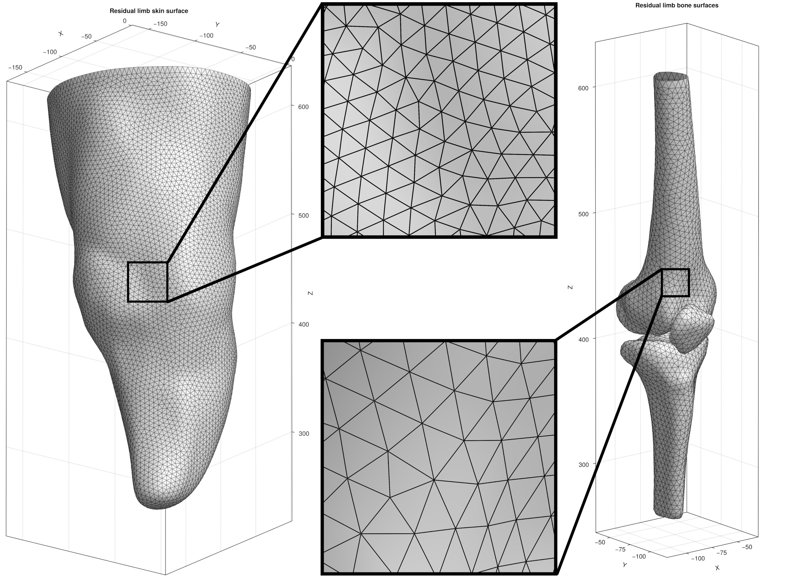
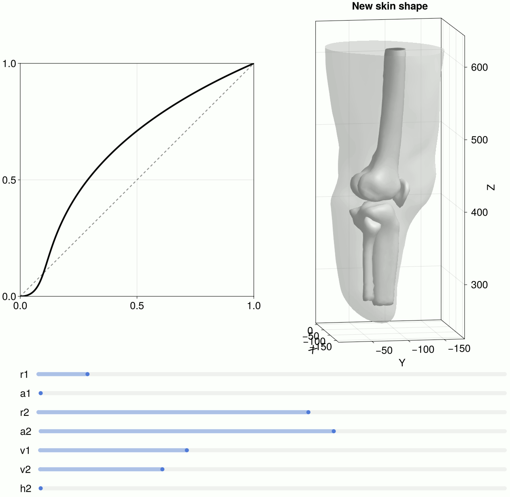

[](https://github.com/SimuLimb/SimulateAmputation.jl/blob/main/LICENSE)
# SimulateAmputation.jl

<div>
    
</div>

## About 
`SimulateAmputation` is a [Julia](https://julialang.org/) package for the creation of simulated geometries for lower limb amputation. Current demos feature only transtibual amputation. 

<div>
    
    
</div>

## Installation
Since SimulateAmputation is not registred as a package yet, and since it depends on FEBio.jl and Geogram.jl (which are also unregistred) the following is recommended to start using SimulateAmputation: 

1. Create a new folder to define a new environment e.g. `dev_SimulateAmputation`
2. Start Julia in this folder and run `] activate .` to activate the new folder as an environment.
3. Now add SimulateAmputation for development using:
```julia
dev --local https://github.com/SimuLimb/SimulateAmputation.jl
```
4. Now add FEBio.jl for development using: 
```julia
dev --local https://github.com/febiosoftware/FEBio.jl/
```
5. Now add Geogram for development using: 
```julia
dev --local https://github.com/COMODO-research/Geogram.jl.git
```
Note that Mac or Linux users may need to build Geogram locally. See the [Geogram.jl repository](https://github.com/COMODO-research/geogram.jl) for more information. 

6. SimulateAmputation depends on Comodo (a registered package) for many of the geometry processing features. Comodo is added automatically when SimulateAmputation is installed. Users interested in learning more about Comodo should also add it for development using:

```julia
dev --local Comodo
```
8. Next activate the new folder as an environment in your IDE. For VS Code or VS Codium you can simply open the `dev_SimulateAmputation` to activate this environment.

## Getting started
To get started install the package, study the documentation, and test some of the demos provided in the [`examples`](https://github.com/SimuLimb/SimulateAmputation.jl/tree/main/examples) folder. 

## Documentation 
Documentation is under construction. 

### BodyParts3D file names explained
| `FMAID`      | `English name` |
| ----------- | ----------- |
| 7163   | Skin      |
| 16586   | Right hip bone      |
| 24474      | Right femur       |
| 24477      | Right tibia      |
| 24480   | Right fibula       |
| 24480   | Right fibula       |
| 24480   | Right fibula       |
| 24480   | Right fibula       |

## Testing 

## Roadmap
- [ ] Create more examples/demos and for each function
- [x] Create demo featuring parameterised shape changes
- [x] Make repository and REAME feature complete
- [ ] Add testing/CI
- [ ] Add more detailed documentation for functions 

## How to contribute? 
Your help would be greatly appreciated! If you can contribute please do so by posting a pull-request. I am very much open to fully acknowledging your contributions e.g. by listing you as a contributor properly whereever possible, by welcoming you on board as a long term contributor, or by inviting you to be a co-author on publications featuring SimulateAmputation functionality. 

## License 
SimulateAmputation.jl is released open source under the [Apache 2.0 license](https://github.com/SimuLimb/SimulateAmputation.jl/blob/main/LICENSE).
